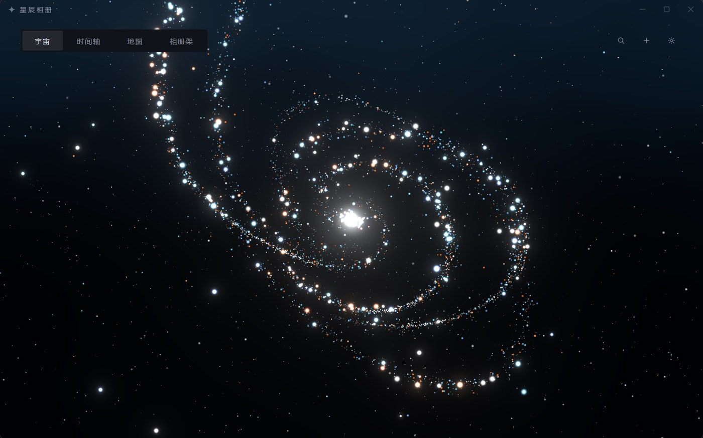
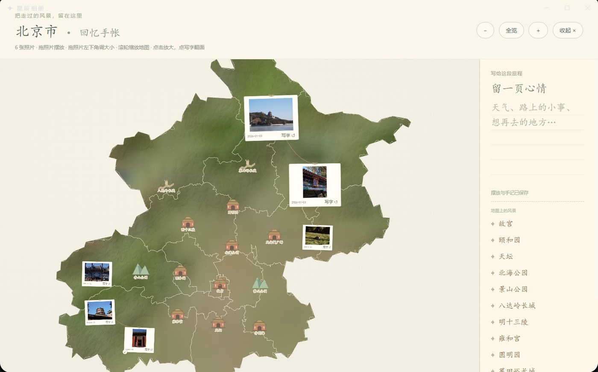

# ✨ 星辰相册 · Stellar Memories

> 把你的照片变成一片可以探索的宇宙 —— 星系、时间轴与记忆地球。


--1.0.0-purple)


星辰相册是一款**本地优先**的桌面照片管理应用：照片不再是网格里的缩略图，而是漂浮在星系中的星辰。它没有账号、没有云端、没有遥测 —— 你的照片永远只留在你自己的电脑上。

<p align="center">
  
  
</p>

> 听说，每一个记忆碎片，都是一颗孤独的星星。当千万张照片汇聚在一起，便成了属于你的浩瀚星河。🌌
> 把记忆存进星辰，让回忆在掌心流转。在【星辰相册】，你的每一次回眸，都是宇宙级的浪漫。

## 🎬 视频演示

📺 抖音实机演示：[**点击观看**](https://v.douyin.com/HVZguP1VAP4/)

## ✨ 功能特性

- **🌌 宇宙视图** —— 每个相册是一座星系，每张照片是一颗星辰；支持星座式摆放、聚焦与沉浸式漫游。
- **📅 时间轴** —— 按日期回溯每一天，全文搜索、收藏、查看粒子化的照片动画。
- **🌍 记忆地球** —— 带昼夜光影的三维地球；按拍摄地点聚合照片，拖动即可定位，同一天的照片以彩色弧线相连。
- **🖼️ 省级照片墙** —— 中国省界地形背景上自由摆放、缩放、翻面写字的照片墙与旅行手记。
- **🔒 本地密码保护** —— Argon2 密码哈希或无密码模式，自动锁定。
- **💾 元数据备份** —— 导出/导入照片路径、故事、地点等元数据（不含原图）。
- **🖥️ 动态壁纸** —— 把星系挂到 Windows 桌面壁纸层（WorkerW），图标仍在最上层，多显示器逐个铺满。
- **📱 手机上传** —— 同一 WiFi 下扫码，用手机浏览器把照片传进指定文件夹，自动入库成相册。
- **🗂️ 多页面** —— 可建多个页面，每页独立图形（旋臂 / 球状 / 环状 / 网格 / 波浪）与照片范围。
- **🎬 视频** —— 导入 mp4 / mov / webm 等格式，详情页直接播放，封面自动截帧。
- **📴 完全离线** —— 地球纹理与全部地理边界内置在安装包中，装好即用，无需任何网络。

### 大数据量下的处理策略

导入时会先完整处理前 40 张（EXIF + 缩略图 + 粒子），其余照片立即入库但只占位，
由后台按每批 4 张慢慢补，右下角有进度条可以随时暂停。这样导入几千张时不会因为
几千张全尺寸位图同时驻留而卡死。

### 数据在哪儿？

| 内容 | 位置 | 说明 |
|------|------|------|
| 数据库 | `%APPDATA%\org.stellarmemories.app\stellar.db` | 照片路径、故事、相册、设置 |
| 缩略图 / 粒子缓存 | 同目录 `thumbs/`、`particles/` | 可随时重建 |
| **原图** | **留在你导入时的原目录** | 软件只记录路径，绝不复制、绝不移动 |

## 📦 安装

### 普通用户（推荐）

1. 前往 [**Releases**](../../releases) 页面下载 `StellarMemories_*_x64-setup.exe`
2. 双击安装（如系统提示未知发布者，选择「仍要运行」—— 安装包未做代码签名）
3. 从桌面或开始菜单打开 **星辰相册**

> 系统需要 WebView2 Runtime（Windows 10/11 一般已自带）；缺失时安装器会引导联网安装。

### 系统要求

- Windows 10 (1903+) 或 Windows 11，64 位
- 支持 WebGL 2 的显卡

## 🚀 快速开始

1. **首次打开** —— 设置一个本地密码（或留空直接进入，之后可在设置中切换无密码模式）
2. **导入照片** —— 点击顶栏「+」导入整个文件夹（自动创建对应相册星系）或单张照片
3. **探索四种视图** —— 顶栏在「宇宙 / 时间轴 / 地图 / 相册架」之间切换
4. **给照片定位** —— 地图页点「快速设置位置」，把照片拖到地球上的拍摄地；有 GPS 的照片会自动落位
5. **照片墙** —— 地图上双击省份分组进入省级照片墙，可拖动、缩放、翻面写字

## 🛠️ 从源码构建

```powershell
# 依赖：Node.js 22 LTS、Rust stable、Visual Studio 2022 C++ 桌面开发、WebView2 Runtime
git clone https://github.com/<your-org>/stellar-memories.git
cd stellar-memories
npm ci
npm run tauri dev      # 开发运行
npm test               # 前端回归测试 (vitest)
npm run build          # 前端生产构建 (tsc + vite)
cargo test --release --manifest-path src-tauri/Cargo.toml   # Rust 回归测试
./scripts/build-windows.ps1    # 生成 Windows 安装包
```

安装包输出在 `src-tauri/target/release/bundle/nsis/`。目前仅面向 Windows，未验证 macOS / Linux。仅启动 Vite 的浏览器页面不能替代 Tauri 原生后端。

## 🗺️ 地图数据与第三方资源

项目自带全部地理数据，构建与运行都**不需要** API key：

| 资源 | 来源 | 许可 |
|------|------|------|
| 地球昼夜/地形纹理 | [Solar System Scope](https://www.solarsystemscope.com/textures/) | CC BY 4.0 |
| 世界国界 | [Natural Earth](https://www.naturalearthdata.com/) 110m | Public Domain |
| 中国省市边界 | [DataV.GeoAtlas](https://datav.aliyun.com/portal/school/atlas/area_generator) | 随包分发，见上游条款 |
| 景点坐标 | Wikidata | CC0 |
| 高程底图 | Mapzen / SRTM | 见上游条款 |

完整清单与注意事项见 [THIRD_PARTY_NOTICES.md](THIRD_PARTY_NOTICES.md)。

## 🔒 隐私与安全

- **默认零网络依赖**：不上传照片、无统计埋点、无崩溃上报。
  唯一例外是你主动开启的「手机上传」——那是本机临时起的局域网服务，只在会话期间存在，
  15 分钟无动作自动关闭，数据不出内网；不上传任何内容到互联网。
- 密码使用 Argon2 哈希存储。解锁是应用层访问控制，**不是磁盘加密**。
- 照片资源协议（`tm://`）在锁定状态下返回 403，且禁止持久缓存。
- 仓库不需要任何预置密码或 API key。
- 安全问题请勿公开发 Issue，见 [SECURITY.md](SECURITY.md) 的私下报告流程。

## 📐 项目结构

```
├── src/                  # React 前端
│   ├── ui/               #   界面组件（宇宙/时间轴/地图/相册架/锁屏…）
│   ├── three/            #   Three.js 粒子引擎、星系、地球
│   ├── core/             #   IPC 封装、数据类型、布局算法、设置
│   └── styles/           #   全局样式
├── src-tauri/            # Tauri 2 后端 (Rust)
│   └── src/              #   SQLite、导入、认证、备份、tm:// 资源协议
├── public/maps/          # 内置地理数据（离线可用）
├── tests/                # vitest 回归测试（不含真实照片）
└── scripts/              # 构建 / 审计 / 地图数据准备脚本
```

## 🤝 贡献

欢迎 Issue 与 PR！请先阅读 [CONTRIBUTING.md](CONTRIBUTING.md)。提交前请运行：

```bash
npm test && npm run build && cargo test --release --manifest-path src-tauri/Cargo.toml
```

报告问题时只附脱敏日志、操作步骤和必要的系统信息，不要上传数据库、密码或私人照片。

## 📋 已知限制

- 安装包未做代码签名，Windows SmartScreen 可能提示「未知发布者」。
- 删除照片只移除软件内的记录，不会动你的原文件；反过来，手动删除/移动原文件会让记录失效。
- 恢复备份只还原与现有照片路径匹配的文字记忆，不还原图库本体；完整迁移请复制整个数据目录 + 原图。
- 夜间灯光是静态灯光纹理配合日照计算，不是真实的用电/天气/云层。
- 地图为照片浏览用的可视化数据，不是官方审图标准地图。
- 动态壁纸依赖 Explorer 的 WorkerW 桌面层：Windows 任务栏设为「自动隐藏」或使用第三方
  桌面整理软件时可能表现不一致；Explorer 崩溃重启后需要几秒才会自动重挂。
- 不支持 HEIC / HEIF 原图（iPhone 默认格式）。手机上传页会在浏览器里转成 JPEG，
  这种情况会丢掉 EXIF 里的 GPS 与拍摄时间；想保留这些信息，请在 iPhone 的
  「设置 → 相机 → 格式」里选「兼容性最佳」。
- 视频播放依赖 WebView2 自带的解码能力：H.264 的 mp4 最稳，部分 HEVC / MKV 可能只有声音没有画面。

## 📄 许可证

本项目自有代码以 [PolyForm Noncommercial 1.0.0](LICENSE) 许可证发布。简言之（非法律条文）：

- ✅ 个人使用、学习、研究、非营利用途 —— 免费使用、修改、分享（须保留本许可证与署名）
- ❌ **禁止任何商业用途**：出售、付费下载、捆绑进商业产品、商业服务等均不允许
- 💼 商用授权请联系仓库所有者单独协商第三方库与数据各有其许可，见 [THIRD_PARTY_NOTICES.md](THIRD_PARTY_NOTICES.md)。

## ❤️ 致谢

- [Tauri](https://tauri.app/) · [React](https://react.dev/) · [Three.js](https://threejs.org/) · [MapLibre GL](https://maplibre.org/)
- [Solar System Scope](https://www.solarsystemscope.com/textures/) 的地球纹理
- [Natural Earth](https://www.naturalearthdata.com/) 与 [DataV.GeoAtlas](https://datav.aliyun.com/portal/school/atlas/area_generator) 的地理数据
